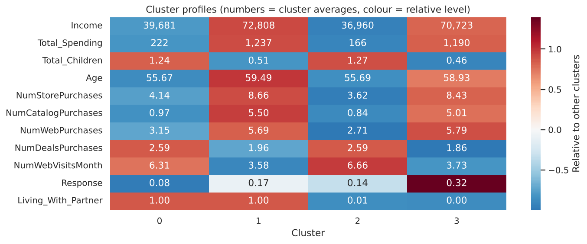
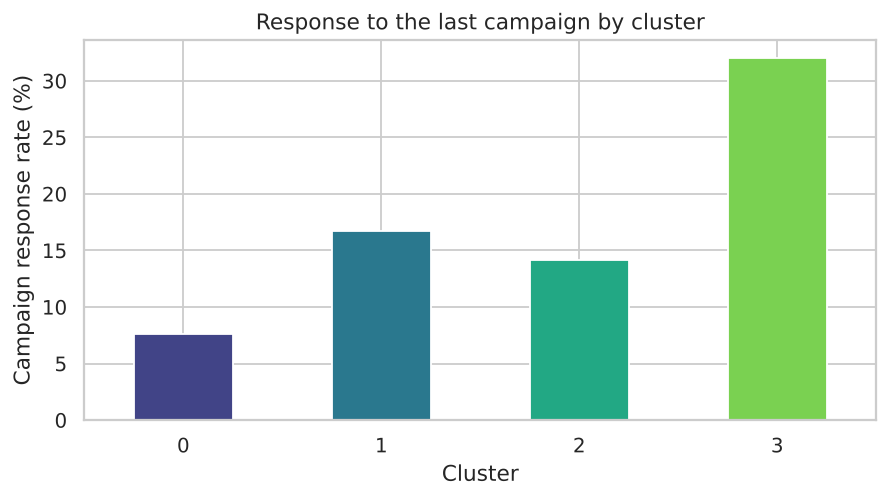
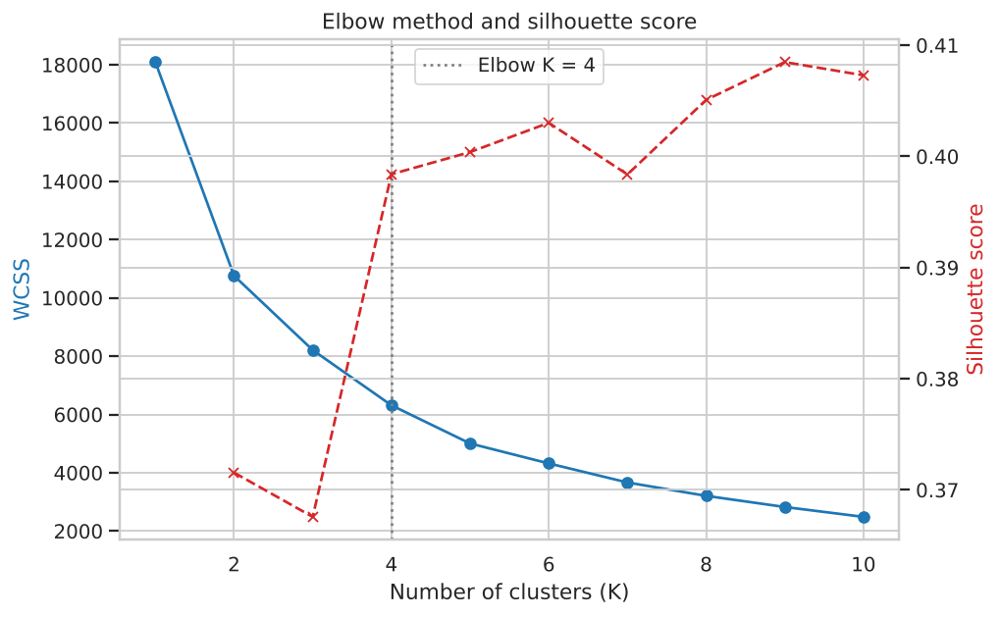
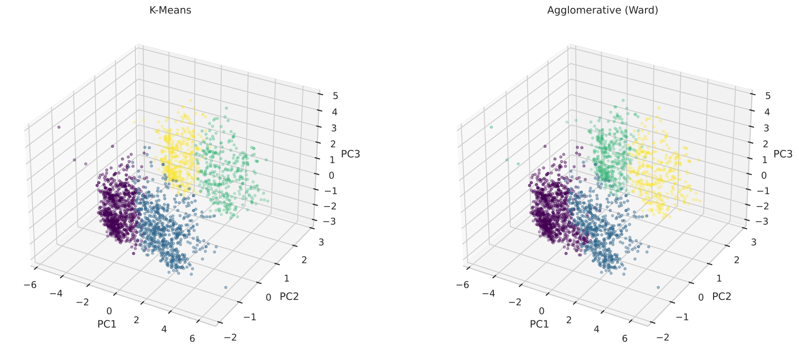

# SmartCart: Customer Segmentation with PCA, K-Means and Hierarchical Clustering

Segment **2,236 supermarket customers** into actionable groups using their demographics, income and purchase behaviour. This is an **unsupervised learning** project (no target label): feature engineering, scaling, PCA, choosing K, K-Means vs Agglomerative clustering, and business profiling of each segment.

## Problem

SmartCart wants to understand its customer base so marketing can target different groups differently instead of treating everyone the same. The dataset has 2,240 customers with 22 raw columns: demographics, income, spending per product category, purchase channels (web / catalog / store), web visits, and response to the last campaign.

## Results: four customer segments

| Cluster | Segment | Customers | Avg. income | Avg. spend | Campaign response |
|---|---|---|---|---|---|
| 0 | **Budget couples & families** | 905 | ~39.7k | ~222 | 7.6% |
| 1 | **Affluent couples** | 534 | ~72.8k | ~1,237 | 16.7% |
| 2 | **Budget solo shoppers** | 444 | ~37.0k | ~166 | 14.2% |
| 3 | **Affluent solo shoppers** | 353 | ~70.7k | ~1,190 | 32.0% |



### Business takeaways

- **Affluent segments (1 and 3)** are about 40% of customers but spend roughly **5 to 7 times more** than the budget segments. They buy mostly through catalog and in-store channels, so those channels suit them best.
- **Budget segments (0 and 2)** visit the website most often (6.3 to 6.7 visits a month) but spend little. Deal-based offers could convert those visits into purchases.
- **Customers living alone respond to campaigns about twice as often** as those living with a partner (for example 32% vs 17% among affluent customers).



## Approach

1. **Cleaning:** filled 24 missing incomes with the median; removed 4 outliers (impossible ages, one extreme income).
2. **Feature engineering:** `Age`, `Customer_Tenure_Days`, `Total_Spending`, `Total_Children`, simplified `Education` (3 levels) and `Living_With` (Partner / Alone).
3. **Encoding and scaling:** one-hot encoding, `StandardScaler`.
4. **PCA:** reduced to 3 components (45% of variance) for clustering and 3D visualisation.
5. **Choosing K:** elbow method (K = 4) and silhouette score.
6. **Clustering:** K-Means and Agglomerative (Ward) with K = 4, compared by silhouette and agreement (ARI 0.87). Agglomerative is used for profiling.
7. **Profiling:** per-cluster averages, heatmap, response rate, named segments.





## Project structure

```
.
├── data/smartcart_customers.csv
├── notebooks/smartcart_customer_segmentation.ipynb   # full analysis with outputs
├── images/
├── requirements.txt
└── README.md
```

## How to run

```bash
git clone https://github.com/<your-username>/smartcart-customer-segmentation.git
cd smartcart-customer-segmentation
pip install -r requirements.txt
jupyter notebook notebooks/smartcart_customer_segmentation.ipynb
```

## Limitations and next steps

- Silhouette scores are modest (about 0.37 to 0.41 for every K from 2 to 10), so the segments overlap. Treat them as practical personas rather than sharp boundaries.
- Three PCA components keep only about 45% of the variance; try more components or clustering on the scaled features directly.
- `Response` was one of the clustering inputs, so the response-rate comparison is partly circular. Validate it on held-out campaign data.
- `Living_With` is a binary feature that strongly shapes the clusters; re-run without it to see whether other structure appears.
- Try Gaussian Mixture Models or DBSCAN, and track segment stability across random seeds.

## Author

**Adarsh Kumar Verma**
